# OVERBURST

OVERBURST는 대검과 다섯 원소의 힘으로 몬스터 무리를 돌파하는 3D 쿼터뷰 핵앤슬래시 액션 RPG입니다. 약공으로 에너지를 모으고, 적의 공격을 패링으로 받아친 뒤, 강공으로 전장을 쓸어버립니다. 사냥에서 얻은 장비와 지도를 챙겨 다음 던전에 도전합니다.

현재 개발 중이며, 아래는 게임플레이·지형·UI 시연 화면입니다.

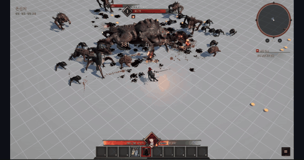

## 대검으로 베고, 모은 힘으로 내려찍기

약공은 네 번의 연속 베기로 이어집니다. 적을 맞힐 때마다 원소 에너지가 차오르고, 강공을 쓰면 모은 에너지를 한 번에 소비합니다. 바로 방출해 눈앞의 적을 정리할지, 공격을 더 이어가 큰 한 방을 준비할지 고를 수 있습니다.

대시로 거리를 좁히고 구르기로 공격을 피한 뒤 다시 파고듭니다. 회피에서 약공·강공으로 이어지는 공격도 있어, 몬스터에 둘러싸였을 때 자리를 바꾸며 싸울 수 있습니다. 대시 강공은 전진하며 회전한 뒤 내려찍어 여러 적을 함께 타격합니다.

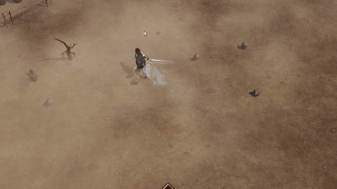

충전량에 맞춰 검신과 검의 궤적이 달라지고, 타격 순간에는 피격 반응과 혈흔, 화면 흔들림이 더해집니다. 넓게 휘두르는 대검의 범위와 적이 쓰러지는 모습을 한 화면에서 볼 수 있습니다.

## 적의 공격을 받아치는 패링

적의 공격이 닿는 순간에 맞춰 강공을 쓰면 패링이 나갑니다. 성공했을 때의 반격은 모아 둔 원소 에너지에 따라 **불완전 패링·일반 패링·완벽 패링**으로 달라집니다.

| 불완전 패링 | 일반 패링 | 완벽 패링 |
|:---:|:---:|:---:|
| 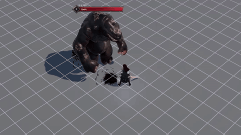 | 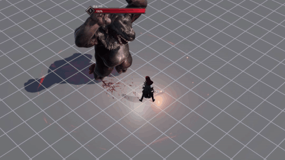 | 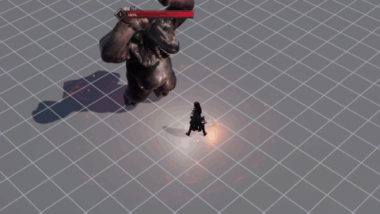 |
| 남은 피해를 받으며 약공 한 번으로 반격합니다. | 적의 자세를 무너뜨리고 회전 베기와 내려찍기로 반격합니다. | 적을 기절시키고 강화 반격을 펼칩니다. 보스에게는 추가 그로기를 쌓습니다. |

일반·완벽 패링은 성공한 순간부터 반격 동작이 끝날 때까지 보호받습니다. 무리 속에서도 반격을 끝까지 밀어붙일 수 있습니다. 완벽 패링의 금속 충돌음과 검 잔상, 짧은 화면 확대는 받아친 순간을 강조합니다.

## 보석 하나로 바뀌는 다섯 원소

장착한 원소보석이 대검에 힘을 부여합니다. 약공으로 쌓는 상태와 강공으로 터뜨리는 효과가 원소마다 달라, 보석을 바꾸면 적을 상대하는 방식도 바뀝니다. 아래 GIF는 각 원소의 강공과 대시 강공을 차례로 보여줍니다.

<table>
<tr><th width="50%">강공·대시 강공</th><th width="50%">원소 효과</th></tr>
<tr>
<td width="50%">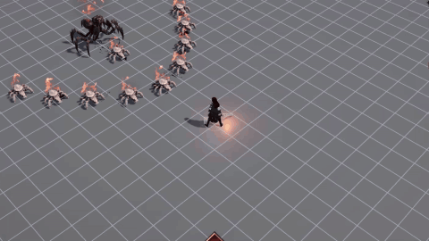</td>
<td><strong>불 · 연쇄 폭발</strong><br>약공으로 적에게 연소를 쌓습니다. 강공이 맞으면 쌓인 상태를 소비해 폭발이 차례로 터집니다. 무리 전체로 번지는 폭발을 노릴 수 있습니다.</td>
</tr>
<tr>
<td>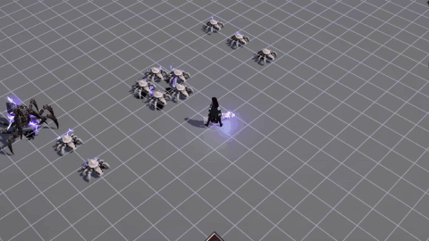</td>
<td><strong>번개 · 연쇄 전격</strong><br>감전을 쌓은 적을 강공으로 때리면 주변 적에게 전격이 이어집니다. 감전 중첩과 충전량에 따라 연결되는 전격이 달라집니다.</td>
</tr>
<tr>
<td>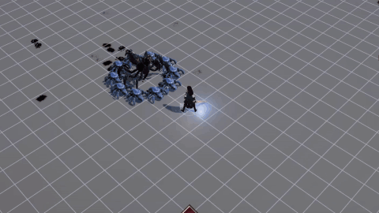</td>
<td><strong>얼음 · 빙결과 쇄빙</strong><br>냉기를 쌓아 일반 적을 얼립니다. 강공은 빙결을 깨뜨리는 쇄빙 파동으로 주변까지 공격합니다.</td>
</tr>
<tr>
<td>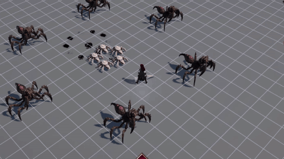</td>
<td><strong>어둠 · 잠식 탄막</strong><br>적마다 잠식을 쌓아 둡니다. 강공으로 직접 맞힌 적의 잠식을 소비하고, 그만큼 화면 안의 적을 향해 탄막을 쏟아냅니다.</td>
</tr>
<tr>
<td>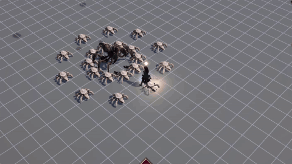</td>
<td><strong>빛 · 광휘와 과충전</strong><br>공격을 이어가며 광휘와 에너지를 모읍니다. 충분히 충전한 강공은 두세 번의 연속 타격으로 이어지고, 대시 강공은 전진하는 파동을 방출합니다.</td>
</tr>
</table>

## 큰 공격 사이의 빈틈을 노리는 보스전

크라스피칸은 두 페이즈로 싸우는 대형 보스입니다. 앞발을 휘두르는 공격과 넓은 범위로 뛰어드는 착지 공격 등, 일반 몬스터와 다른 공방을 펼칩니다. 바닥에 표시되는 공격 예고와 보스의 준비 동작을 읽고, 회피하거나 패링으로 받아칠 수 있습니다.

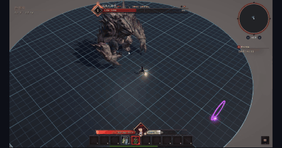

공격이 끝난 틈에 약공으로 에너지를 채우고 강공을 넣습니다. 패링으로 그로기를 쌓아 보스를 무너뜨리면 더 길게 공격할 기회를 얻습니다.

## 지도 한 장으로 떠나는 사막과 동굴

지도에는 던전의 레벨과 등급, 지형, 크기, 몬스터 테마와 옵션이 담겨 있습니다. 어떤 지도를 쓰느냐에 따라 다음 사냥터의 모습과 상대가 달라집니다.

| 동굴 | 사막 |
|:---:|:---:|
| 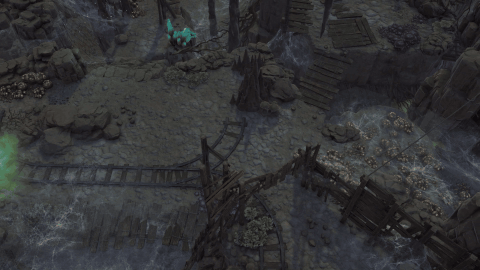 | 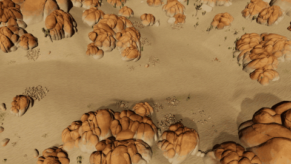 |
| 높이가 다른 플랫폼을 다리와 계단으로 이어 붙입니다. 매번 다른 배치의 통로를 따라 탐험하고 몬스터를 토벌합니다. | 바위 지형 사이에 전투 공간과 통로가 이어집니다. 몬스터 무리를 돌파하며 보스가 기다리는 전장으로 향합니다. |

동굴은 입장할 때 4~20개의 플랫폼으로 조립됩니다. 탐험한 바닥과 다리는 미니맵에 남아, 돌아갈 길과 아직 가 보지 않은 곳을 확인할 수 있습니다. 동굴에서는 몬스터 토벌이, 사막에서는 보스 처치가 던전의 목표입니다.

목표를 달성하면 다음 지도와 귀환 포탈을 얻습니다. 바로 돌아가 전리품을 챙겨도 되고, 남은 적을 더 사냥해도 됩니다. **귀환 전에 죽거나 탐험을 포기하면 이번 던전에서 얻은 전리품을 잃습니다.** 더 사냥할지, 챙긴 아이템을 가지고 돌아갈지 직접 결정합니다.

## 얻은 장비로 다음 사냥을 준비하기

무기와 방어구, 원소보석, 물약, 가방을 모으고 옵션을 비교해 장비를 바꿉니다. 공격 속도와 치명타, 원소 피해, 약공·강공 피해처럼 전투에 쓰이는 수치를 장비 창에서 확인할 수 있습니다. 원소보석도 효과와 옵션을 보고 골라 장착합니다.

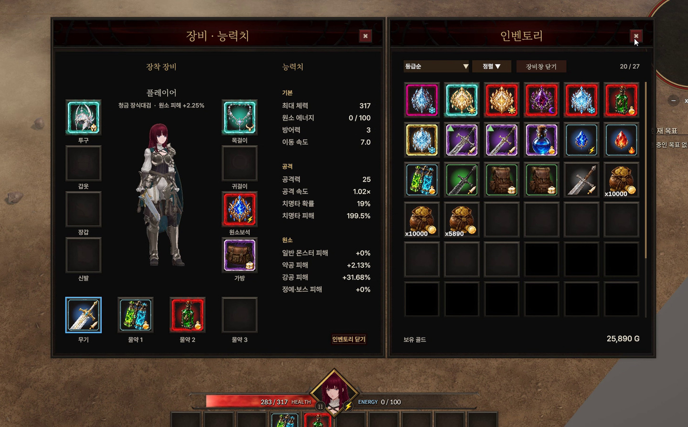

물약은 세 칸에 장착하고, 아이템은 열 칸의 퀵슬롯에서 사용합니다. 마을의 공유 보관함에 전리품을 맡기고, 다음 지도에 맞는 장비를 준비할 수 있습니다.

외모도 캐릭터마다 바꿀 수 있습니다. 얼굴과 머리 모양, 머리·눈 색, 피부색과 체형을 고르고, 장비를 입힌 모습까지 미리 확인합니다. 고른 외모는 캐릭터에 저장되어 게임 속 모습에 적용됩니다.

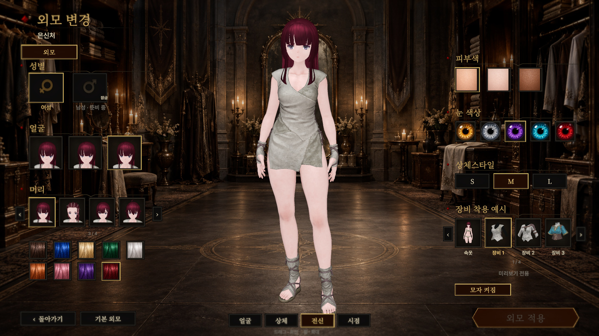

## 마을에서 의뢰를 받고 돌아와 보고하기

마을에는 무기·방어구·잡화·물약 상인과 치장사가 있습니다. 상인의 의뢰를 받아 사냥하고, 목표를 달성하면 다시 찾아가 보상을 받습니다. 의뢰 내용과 진행 상황은 퀘스트 목록과 화면의 목표 표시에서 확인할 수 있습니다.

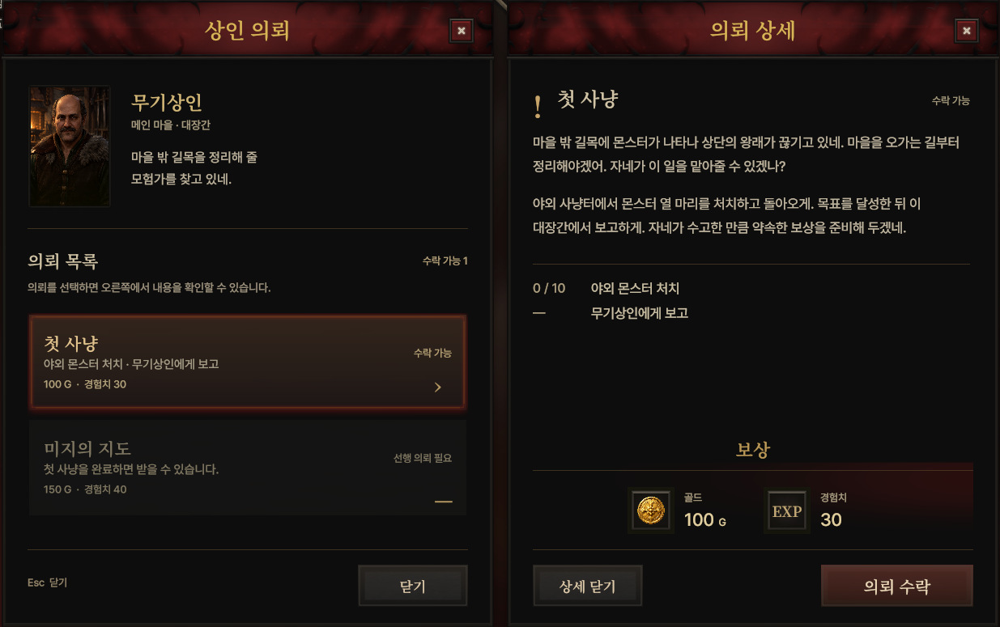

상인과의 우호도를 올리면 구매 할인을 받을 수 있습니다. 사냥에서 돌아와 전리품을 정리하고, 물약을 보충하고, 다음 의뢰와 지도를 고르는 곳이 마을입니다.

## 직접 실행하기

개발 소스는 [`JC` 브랜치](https://github.com/jcsoftd/ProjectOverburst/tree/JC)를 기준으로 합니다. **Unity 6 `6000.3.15f1`**을 사용합니다.

```bash
git clone --branch JC https://github.com/jcsoftd/ProjectOverburst.git
```

1. Unity Hub에서 내려받은 저장소 폴더를 Unity `6000.3.15f1`로 엽니다. Unity Package Manager 패키지는 [`Packages/manifest.json`](Packages/manifest.json)에 따라 복원됩니다.
2. 별도 라이선스가 필요한 외부 자산을 복원합니다. DunGen, Easy Save, Feel, RPG and MMO UI 11, MicroVerse, See-through Shader와 사용한 환경·모델·애니메이션·VFX 패키지가 필요합니다. `Assets/ThirdParty`와 [`.gitignore`](.gitignore)에 명시된 제외 경로를 확인하고, 원본과 파생 씬·프리팹·아트를 원래 경로와 GUID를 유지해 복원합니다.
3. [`Assets/ProjectOverburst/00_Scenes/PersistentScene.unity`](Assets/ProjectOverburst/00_Scenes/PersistentScene.unity)를 열고 Play를 누릅니다. 이 씬에서 계정과 상주 UI를 준비하고 메인 마을로 진입합니다.

Asset Store 원본과 재배포할 수 없는 파생 자산은 공개 Git에 포함하지 않습니다. 메인 마을과 일부 UI·환경·전투 효과에는 제작자가 보관한 복원본도 필요하므로, 저장소만 내려받은 상태에서는 전체 게임을 실행할 수 없습니다.

| 입력 | 동작 |
|---|---|
| `WASD` / 방향키 | 이동 |
| 마우스 왼쪽 / 오른쪽 | 약공 / 강공·패링 |
| `Shift` | 대시·회피 |
| `X` | 전투 모드 전환 |
| `F` | NPC·포탈·아이템 상호작용 |
| `Tab` / `C` / `J` | 인벤토리 / 장비 / 퀘스트 목록 |
| `1`~`9`, `0` | 퀵슬롯 1~10 |
| `Esc` | 창 닫기·취소 |
